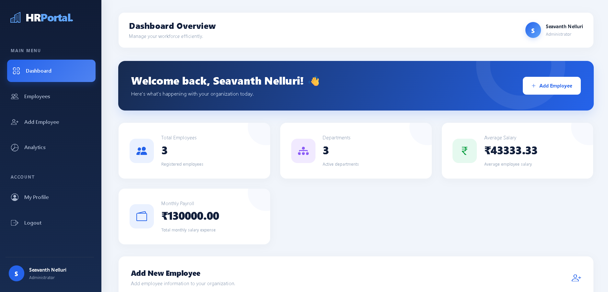

# Automated CI/CD Pipeline for Employee Management System

A Python Flask-based Employee Management System with an automated CI/CD pipeline using GitHub Actions, Docker, Pytest, Flake8, and GitHub Container Registry (GHCR).

## Project Overview

This project demonstrates how to develop, test, containerize, and deploy a Flask web application using modern DevOps practices.

The application allows users to manage employee records through a dashboard with authentication, employee management features, and department analytics.

## Key Features

- User registration and login
- Secure password hashing
- Employee management (Create, Read, Update, Delete)
- Employee search
- Department-wise employee distribution
- Dashboard analytics
- SQLite database integration
- Docker containerization
- Persistent database storage using Docker volumes
- Automated testing with Pytest
- Code quality checking with Flake8
- Automated CI/CD using GitHub Actions
- Docker image publishing to GHCR
- Cloud deployment using Render

## Technology Stack

| Category | Technologies |
|---|---|
| Backend | Python, Flask |
| Frontend | HTML, CSS, JavaScript |
| Database | SQLite |
| Testing | Pytest |
| Code Quality | Flake8 |
| Containerization | Docker, Docker Compose |
| CI/CD | GitHub Actions |
| Container Registry | GitHub Container Registry |
| Deployment | Render |
| Version Control | Git, GitHub |

## Application Screenshot



## Project Architecture

```text
Developer
   |
   v
GitHub Repository
   |
   v
GitHub Actions
   |
   +----------------------+
   |                      |
   v                      v
Pytest Testing        Flake8 Checking
   |                      |
   +----------+-----------+
              |
              v
       Docker Build
              |
              v
       GitHub Container
          Registry
              |
              v
       Application
         Deployment
              |
              v
           Render
              |
              v
       Live Flask App
```

## CI/CD Pipeline

The GitHub Actions workflow automates the following stages:

1. Developer pushes code to the `main` branch.
2. GitHub Actions automatically starts the workflow.
3. Required Python dependencies are installed.
4. Flake8 checks the code quality.
5. Pytest executes application tests.
6. Docker image is built after successful testing.
7. Docker image is published to GitHub Container Registry.

## Docker Configuration

The application is containerized using Docker.

Docker Compose manages the application container and database volume.

To start the application:

```bash
docker compose up -d --build
```

To check container status:

```bash
docker compose ps
```

To stop the application:

```bash
docker compose down
```

**Note:** The database uses a Docker volume to preserve employee records across container restarts. Avoid deleting the volume when stopping the application.

## Running Locally

### 1. Clone the repository

```bash
git clone https://github.com/seavanth2003/DevOps-CICD-Project.git
```

### 2. Navigate to the project

```bash
cd DevOps-CICD-Project
```

### 3. Create a virtual environment

```bash
python -m venv venv
```

### 4. Activate the virtual environment

Windows PowerShell:

```powershell
.\venv\Scripts\Activate.ps1
```

### 5. Install dependencies

```bash
pip install -r requirements.txt
```

### 6. Configure environment variables

Create a `.env` file in the project root and configure a strong secret key:

```env
SECRET_KEY=your-secret-key
```

Do not commit your actual `.env` file to GitHub.

### 7. Run the application

```bash
python app/app.py
```

## Running Tests

Execute the test suite:

```bash
pytest -v
```

Check code quality:

```bash
flake8 app/ tests/ --count --statistics
```

## Deployment

The application is deployed using Render with Docker.

The GitHub repository is connected to the deployment service to support application updates through the deployment workflow.

## Project Structure

```text
DevOps-CICD-Project/
│
├── .github/
│   └── workflows/
│       └── ci-cd.yml
│
├── app/
│   ├── app.py
│   ├── auth.py
│   ├── database.py
│   ├── templates/
│   └── static/
│
├── tests/
│
├── Dockerfile
├── docker-compose.yml
├── requirements.txt
├── .dockerignore
├── .gitignore
└── README.md
```

## Learning Outcomes

Through this project, I gained practical experience in:

- Building a Python Flask web application.
- Writing automated tests using Pytest.
- Performing code quality checks using Flake8.
- Containerizing applications using Docker.
- Managing containers using Docker Compose.
- Automating CI/CD workflows using GitHub Actions.
- Publishing Docker images to GHCR.
- Deploying applications using Render.
- Managing application configuration and environment variables.

## Author

**Siva Sai Krishna Seavanth Nelluri**

GitHub: seavanth2003